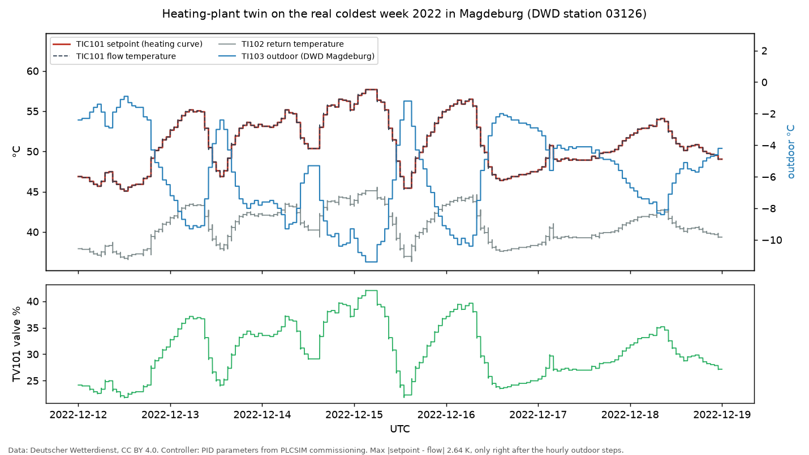

# heating-plant-aas

A weather-compensated heating plant, commissioned on a Siemens S7-1500 (PLCSIM), turned into an **Industrie 4.0 component**: a Python twin of the same control loop, an **OPC UA server** with a typed information model, and an **Asset Administration Shell (AAS)** built from official IDTA templates. A client that knows nothing about the plant reads the AAS, finds the OPC UA endpoint and datapoints in it, and connects. No hand-written tag list.



*The twin running through 12–18 Dec 2022 with the real hourly outdoor temperature of DWD station Magdeburg. The heating curve sets the flow temperature, the PID moves the mixing valve, and flow follows setpoint.*

## What is in it

```
 DWD hourly outdoor temperature (real data)
            │
            ▼
 ┌──────────────────────────────┐        OPC UA (asyncua)                   AAS (.aasx, IDTA templates)
 │ Plant twin, 100 ms cycle     │  ──►  HeatingPlant                         ├─ Digital Nameplate 3.0
 │ heating curve → PID → valve  │        ├─ TIC101  SP · PV · OP            ├─ Technical Data 2.0
 │ → dead time → PT1            │        ├─ TI102   PV                      └─ Asset Interfaces Description 1.2
 │ (1:1 port of the SCL blocks) │        └─ TI103   PV  (writable)                 endpoint + href per datapoint
 └──────────────────────────────┘        AnalogItemType, EURange, UNECE units        │
                                                    ▲                                │
                                                    └──────── AID client ◄───────────┘
                                                      reads only the AASX, subscribes
```

| Part | File | Standard |
|---|---|---|
| Plant twin | `heating_plant/model.py` | Port of `FC_Heizkurve` and `FB_StreckeVorlauf` from the PLC project; 2-DOF PIDT1 as documented for PID_Compact |
| OPC UA server | `heating_plant/opcua_server.py`, `model/HeatingPlant.NodeSet2.xml` | Own ObjectTypes (`HeatingPlantType`, `TemperatureControlLoopType`, `TemperatureIndicatorType`, `HeatingCurveType`) with mandatory members (OPC 10000-3); values as AnalogItemType with EURange and EngineeringUnits (OPC 10000-8), UNECE Rec. 20 units |
| AAS | `heating_plant/aas_builder.py`, `model/HeatingPlant.aasx` | AAS metamodel V3.0; IDTA 02006-3-0 Digital Nameplate, IDTA 02003-2-0 Technical Data, IDTA 02017 1.2 Asset Interfaces Description, IDTA 02008-1-1 Time Series Data (the Magdeburg week, 168 hourly records) |
| AID client | `heating_plant/aid_client.py` | AID OPC UA binding: `href = nsu=…;s=…`, `uav:browsePath`, and security from `uav:channelsec` / `uav:authentication` (OPC 10101 WoT binding) |
| AAS REST API | `heating_plant/aas_server.py` | IDTA 01002 AAS Part 2 API v3.1 via the Eclipse BaSyx Python server (read-only repository: `/shells`, `/submodels`, element by idShort path) |
| Hardware path | `heating_plant/tclab_backend.py` | TCLab (Arduino temperature lab): step test, two-point FOPDT identification, SIMC PI; `--plant tclab-emulator` / `--plant tclab` run the same OPC UA model on it |
| Security | `heating_plant/security.py` | OPC UA Basic256Sha256, SignAndEncrypt, X.509 application certificates with trust list, UserName token (OPC 10000-2/-4/-7); password checked as PBKDF2-HMAC-SHA256 hash |

## How it is validated

| Check | Against | Result |
|---|---|---|
| Heating curve, 3 operating points | PLCSIM commissioning log (tests 0, 0b, 6) | exact |
| Steady valve position, 4 operating points | PLCSIM: 20.48 / 43.52 / 38.65 / 33.82 % | within 0.06 % |
| Pump loop PDIC301: load 50 / 90 / 20 % at 1.0 bar | PLCSIM: 74.11 / 87.26 / 68.53 % speed, 6.85 / 12.33 / 2.74 m³/h; release logic tests 13–18 | identical to 0.01 |
| Setpoint step 44 → 56 °C | PLCSIM trace: dead time 10 s, 56 °C after 60 s, peak 56.71 °C at 72 s | 10.4 s, 63 s, 56.70 °C at 73.5 s |
| NodeSet, independent check | Second OPC UA stack (node-opcua) loads `HeatingPlant.NodeSet2.xml` with the standard nodeset | pass, in CI |
| OPC UA model | ObjectTypes and type definitions; OPC 10000-8: type, data type, EURange, unit namespace; read-only measurements | automated client test |
| AAS files | IDTA `aas-test-engines` (metamodel, constraints, AASX package) | pass |
| AAS submodels | Element by element against the official IDTA template JSON (mandatory elements, semantic IDs) | pass |
| AID | Every `href` and browse path resolves to the same node on the live server | pass |
| AAS REST API | `/shells` and every `/submodels/{id}` return what the AASX contains; writes refused | pass |
| TCLab path (emulator) | Identified gain vs the emulator's own energy balance; SIMC PI reaches 44 °C; same OPC UA model served | pass (hardware itself not tested) |
| Security | Basic256Sha256 SignAndEncrypt + UserName: trusted client reads; no encryption, wrong password, untrusted certificate are each refused | pass |

The PLCSIM values come from the author's TIA Portal V19 project (commissioned 25 Sep 2026). Every number in this repository is traced in [SOURCES.md](SOURCES.md) as measured, standard/datasheet, design decision, or assumption.

## Run it

```bash
python -m venv .venv && .venv/Scripts/pip install -r requirements.txt   # Linux/macOS: .venv/bin/pip
export HEATING_PLANT_PASSWORD=...                                       # Windows: set HEATING_PLANT_PASSWORD=...
python -c "import asyncio;from heating_plant import security as s;c,_=asyncio.run(s.ensure_certificate('client',s.CLIENT_URI,False));s.trust(c)"
python -m heating_plant.opcua_server --outdoor dwd --time-lapse 600    # secure server; replays the Magdeburg week, 1 h = 6 s
python -m heating_plant.aid_client model/HeatingPlant.aasx 30           # second terminal: connects using only the AAS
python -m heating_plant.aas_server                                       # AAS Part 2 REST API on http://127.0.0.1:8081/api/v3.1/shells
python -m pytest                                                        # all checks
```

The second line creates the client certificate and puts it into the server's trust list, the step an administrator does once. Certificates live in `pki/` (git-ignored); the password is only read from the environment. `--insecure` starts a local demo without encryption or login, and `--outdoor manual` makes `TI103.PV` writable from any OPC UA client (e.g. UaExpert), so you can change the weather by hand.

## Limits (on purpose)

- **Certificates are self-signed.** A plant would use certificates from its own CA (OPC UA GDS or company PKI) and certificate revocation lists.
- **PID_Compact** is reproduced from its documented structure. Siemens-internal details are not public, so the dynamic test uses tolerances.
- **Technical Data properties** use concept descriptions defined in this repo, because no ECLASS/IEC CDD properties could be verified free of charge for these quantities.
- **Not a product:** the nameplate says so. It describes a demonstrator, not something you can order.

## Kurz auf Deutsch

Eine Heizzentrale mit witterungsgeführter Vorlauftemperaturregelung (S7-1500, PLCSIM) als Industrie-4.0-Komponente: Python-Zwilling derselben Regelstrecke, OPC-UA-Server mit typisiertem Informationsmodell und eine Verwaltungsschale aus offiziellen IDTA-Vorlagen. Ein Client liest nur die Verwaltungsschale (Asset Interfaces Description) und verbindet sich damit selbstständig. Der Zwilling ist gegen die PLCSIM-Inbetriebnahme geprüft und läuft mit echten DWD-Außentemperaturen aus Magdeburg.

## Licence

Code: MIT. Weather data: Deutscher Wetterdienst, CC BY 4.0. IDTA submodel templates in `standards/idta/`: CC BY 4.0, unchanged copies from github.com/admin-shell-io/submodel-templates.
