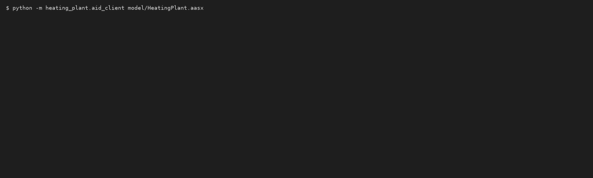
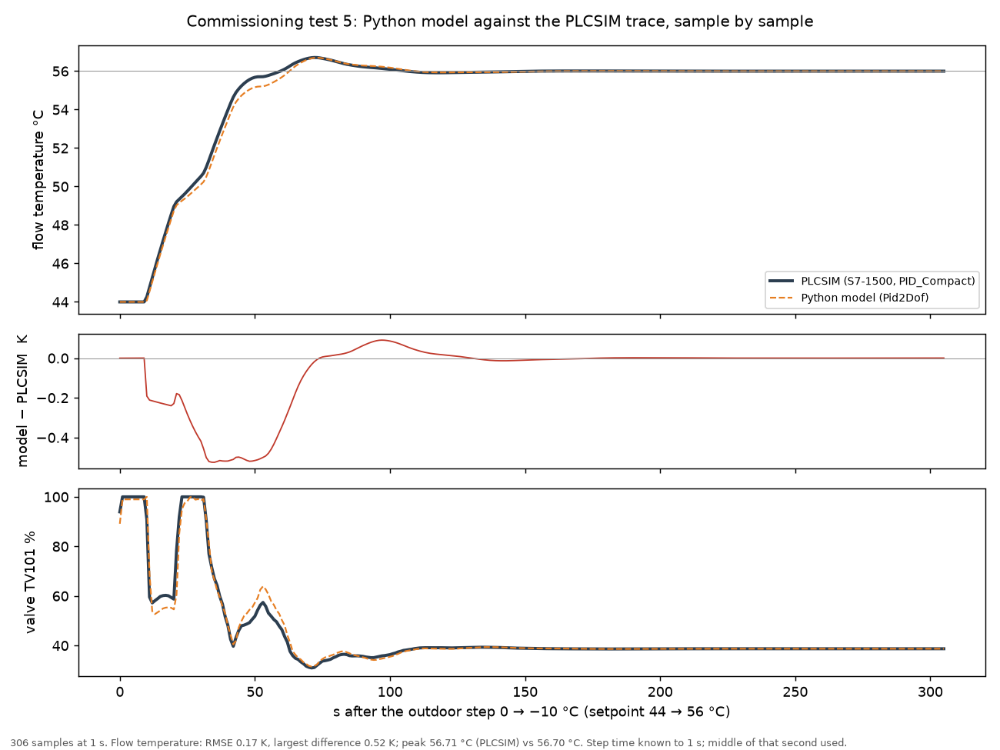
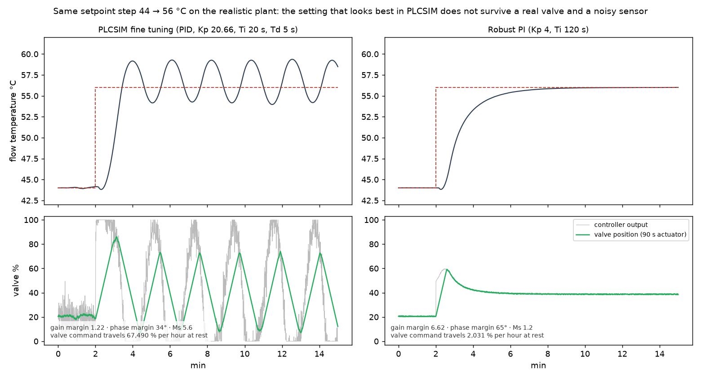

# heating-plant-aas

[](https://github.com/sulemanali5760/heating-plant-aas/actions/workflows/ci.yml)

A weather-compensated heating plant, commissioned on a Siemens S7-1500 (PLCSIM), turned into an **Industrie 4.0 component**: a Python twin of both control loops, a secured **OPC UA server** with a typed information model, and an **Asset Administration Shell (AAS)** built from official IDTA templates and served through the standard AAS REST API. A client that knows nothing about the plant reads the AAS, finds the endpoint, the security settings and the datapoints in it, and connects. No hand-written tag list.

The same idea as a tool for any asset: the **gateway** takes one AAS file, connects to whatever OPC UA server that file describes, and publishes the live values through the AAS REST API. It reconnects by itself and is tested against a second, unrelated server without a code change.



*Recorded run: the client opens `HeatingPlant.aasx`, learns from the Asset Interfaces Description that the server wants Basic256Sha256 / SignAndEncrypt and a UserName login, connects and reads all 12 datapoints.*


*The twin running through 12–18 Dec 2022 with the real hourly outdoor temperature of DWD station Magdeburg. The heating curve sets the flow temperature, the PID moves the mixing valve, and flow follows setpoint.*

## Three results

**1. The Python model follows the PLCSIM trace sample by sample.** All 306 samples of the exported TIA trace (setpoint step 44 → 56 °C) are in `data/plcsim/`; flow temperature RMSE 0.17 K, largest difference 0.52 K, same peak (56.71 vs 56.70 °C).



What this shows: the port is correct and the rebuilt `Pid2Dof` behaves like Siemens PID_Compact. What it does not show: anything about a real heating plant, because the plant in PLCSIM is the author's own model with the same equations.

**2. The controller setting that looks best in PLCSIM is not robust.** The PID from PLCSIM fine tuning (Kp 20.66, Ti 20 s, Td 5 s) has a gain margin of only 1.22 at 0 °C and 1.02 at +10 °C: in mild weather it oscillates even on the unchanged PLC model. With a 90 s valve actuator and 0.05 K sensor noise it never settles and asks the valve for 67 000 % of travel per hour. A PI with Kp 4, Ti 120 s keeps gain margin > 5 and Ms < 1.3 over the whole heating season and settles the same step without overshoot.



The reason is in the plant: the return water flows back into the mixing valve, so the "60 s" circuit reacts like a slow, nearly integrating process, and its static gain changes about 20-fold between −12 °C and +15 °C. `heating_plant/tuning.py` computes the margins from the linearised loop and confirms them by simulation. Not yet checked: the same mild-weather test in PLCSIM itself.

**3. One AAS file is enough to connect.** See the gateway below.

## What is in it

```
 DWD hourly outdoor temperature (real data)          optional: TCLab rig / emulator instead of the mixing circuit
            │                                                         │
            ▼                                                         ▼
 ┌──────────────────────────────┐   OPC UA, Basic256Sha256        AAS (.aasx, IDTA templates)
 │ Plant twin, 100 ms cycle     │   SignAndEncrypt + login        ├─ Digital Nameplate 3.0
 │ TIC101: heating curve → PID  │──► HeatingPlant                  ├─ Technical Data 2.0
 │   → mixing valve → PT1       │    ├─ TIC101  SP · PV · OP       ├─ Asset Interfaces Description 1.2
 │ PDIC301: release → PI → pump │    ├─ PDIC301 SP · PV · OP       │    endpoint, security, href per datapoint
 │   → network (affinity law)   │    ├─ TI102, TI103 PV            └─ Time Series Data 1.1 (Magdeburg week)
 │ (1:1 port of the SCL blocks) │    └─ Simulation inputs                 │                │
 └──────────────────────────────┘    typed ObjectTypes, AnalogItems      │                ▼
                                               ▲                         │      AAS Part 2 REST API (BaSyx)
                                               └──── AID client ◄────────┘
                                         reads only the AASX, applies its security, reads the values
```

| Part | File | Standard |
|---|---|---|
| Plant twin | `heating_plant/model.py` | Port of `FC_Heizkurve`, `FB_StreckeVorlauf`, `FB_Netzpumpe`, `FB_ModellNetz` from the PLC project; 2-DOF PIDT1 as documented for PID_Compact |
| OPC UA server | `heating_plant/opcua_server.py`, `model/HeatingPlant.NodeSet2.xml` | Own ObjectTypes (`HeatingPlantType`, `ControlLoopType`, `TemperatureIndicatorType`, `HeatingCurveType`, `SimulationInputsType`) with mandatory members (OPC 10000-3); values as AnalogItemType with EURange and EngineeringUnits (OPC 10000-8), UNECE Rec. 20 units |
| AAS | `heating_plant/aas_builder.py`, `model/HeatingPlant.aasx` | AAS metamodel V3.0; IDTA 02006-3-0 Digital Nameplate, IDTA 02003-2-0 Technical Data, IDTA 02017 1.2 Asset Interfaces Description, IDTA 02008-1-1 Time Series Data (the Magdeburg week, 168 hourly records) |
| AID client | `heating_plant/aid_client.py` | AID OPC UA binding: `href = nsu=…;s=…`, `uav:browsePath`, and security from `uav:channelsec` / `uav:authentication` (OPC 10101 WoT binding) |
| AAS REST API | `heating_plant/aas_server.py` | IDTA 01002 AAS Part 2 API v3.1 via the Eclipse BaSyx Python server (read-only repository: `/shells`, `/submodels`, element by idShort path) |
| Hardware path | `heating_plant/tclab_backend.py` | TCLab (Arduino temperature lab): step test, two-point FOPDT identification, SIMC PI; `--plant tclab-emulator` / `--plant tclab` run the same OPC UA model on it |
| Security | `heating_plant/security.py` | OPC UA Basic256Sha256, SignAndEncrypt, X.509 application certificates with trust list, UserName token (OPC 10000-2/-4/-7). Both sides check each other: the server only accepts trusted client certificates, the client only talks to the server certificate it was given. Written inputs are range-checked |
| Gateway | [aidconnect](https://github.com/sulemanali5760/aidconnect) (own library, split out of this repository) | AAS file → AID → OPC UA connection → submodel `OperationalData` with live values on the AAS Part 2 REST API. Remote AAS files only over https with a pinned SHA-256; reconnect with back-off; read-only towards the asset |
| Realistic plant | `HeatingPlant.realistic()` in `heating_plant/model.py` | Adds what the PLC model leaves out: valve actuator run time, sensor noise, dead time that follows the network flow. Off by default, so the 1:1 port stays comparable with PLCSIM |
| Robustness | `heating_plant/tuning.py` | Gain margin, phase margin and Ms of loop TIC101 from the linearised plant; overshoot, settling time and valve travel by simulation |
| PLCSIM trace | `heating_plant/plcsim.py`, `data/plcsim/` | Exported TIA Portal trace of commissioning test 5 (hash-pinned) and the sample-by-sample comparison |

## How it is validated

| Check | Against | Result |
|---|---|---|
| Heating curve, 3 operating points | PLCSIM commissioning log (tests 0, 0b, 6) | exact |
| Steady valve position, 4 operating points | PLCSIM: 20.48 / 43.52 / 38.65 / 33.82 % | within 0.06 % |
| Pump loop PDIC301: load 50 / 90 / 20 % at 1.0 bar | PLCSIM: 74.11 / 87.26 / 68.53 % speed, 6.85 / 12.33 / 2.74 m³/h; release logic tests 13–18 | identical to 0.01 |
| Setpoint step 44 → 56 °C | PLCSIM trace: dead time 10 s, 56 °C after 60 s, peak 56.71 °C at 72 s | 10.4 s, 63 s, 56.70 °C at 73.5 s |
| Same step, whole trace | 306 samples of the exported PLCSIM trace (`data/plcsim/`) | flow RMSE 0.17 K, max 0.52 K; valve RMSE 2.1 % |
| Controller robustness | Linear margins, cross-checked by simulation at 0 and +12 °C | PLCSIM PID: gain margin 1.02–1.59; robust PI: > 5 |
| Realistic plant | 90 s actuator, 0.05 K noise, flow-dependent dead time | robust PI: no overshoot, settled in 256 s; PLCSIM PID: limit cycle |
| Gateway | Heating plant over the secured channel, from its AAS file only (an unrelated asset is tested in aidconnect) | live values on REST; plant switched off and on again: reconnects |
| Pump status | `P301.Running`, `P301.DriveFault`, speed and flow; simulated drive fault | pump stops, fault reported, restarts when cleared; status is read-only |
| Written inputs | NaN and out-of-range writes to curve parameters and simulation inputs | undone, controller unaffected |
| NodeSet, independent check | Second OPC UA stack (node-opcua) loads `HeatingPlant.NodeSet2.xml` with the standard nodeset | pass, in CI |
| OPC UA model | ObjectTypes and type definitions; OPC 10000-8: type, data type, EURange, unit namespace; read-only measurements | automated client test |
| AAS files | IDTA `aas-test-engines` (metamodel, constraints, AASX package) | pass |
| AAS submodels | Element by element against the official IDTA template JSON (mandatory elements, semantic IDs) | pass |
| Units | Every own concept description carries IEC 61360 content (name, definition, data type, unit) | pass |
| AID | Every `href` and browse path resolves to the same node on the live server | pass |
| AAS REST API | `/shells` and every `/submodels/{id}` return what the AASX contains; writes refused | pass |
| TCLab path (emulator) | Identified gain vs the emulator's own energy balance; SIMC PI reaches 44 °C; same OPC UA model served | pass (hardware itself not tested) |
| Security | Basic256Sha256 SignAndEncrypt + UserName: trusted client reads; no encryption, wrong password, untrusted client certificate and a wrong server certificate are each refused with the expected error, while the server keeps serving a good client | pass |

The PLCSIM values come from the author's TIA Portal V19 project (commissioned 25 Sep 2026). Every number in this repository is traced in [SOURCES.md](SOURCES.md) as measured, standard/datasheet, design decision, or assumption.

## Run it

```bash
python -m venv .venv && .venv/Scripts/pip install -r requirements.txt   # Linux/macOS: .venv/bin/pip
export HEATING_PLANT_PASSWORD=...                                       # Windows: set HEATING_PLANT_PASSWORD=...
python -c "import asyncio;from heating_plant import security as s;c,_=asyncio.run(s.ensure_certificate('client',s.CLIENT_URI,False));s.trust(c)"
python -m heating_plant.opcua_server --outdoor dwd --time-lapse 600    # secure server; replays the Magdeburg week, 1 h = 6 s
python -m heating_plant.aid_client model/HeatingPlant.aasx 30           # second terminal: connects using only the AAS
python -m heating_plant.aas_server                                       # AAS Part 2 REST API on http://127.0.0.1:8081/api/v3.1/shells
python -m heating_plant.live                                            # aidconnect gateway: live values on http://127.0.0.1:8082/api/v3.1/submodels
python -m heating_plant.tuning                                          # margins and realistic-plant report
python -m pytest                                                        # all checks
```

### On another machine or another asset

```bash
python -m heating_plant.opcua_server --endpoint opc.tcp://192.168.0.10:4840/heating-plant/ --plant realistic
python -m heating_plant.aas_builder --endpoint opc.tcp://192.168.0.10:4840/heating-plant/ --out site/
python -m aidconnect serve https://example.org/site/HeatingPlant.aasx --sha256 <hash> --server-cert server_cert.der --username operator
```

The gateway needs three things from the operator and nothing else: the AAS file (or its URL and hash), the server's certificate, and the password (`AIDCONNECT_PASSWORD`). Endpoint, security mode, datapoints, types and units come from the file. It works with any AAS whose Asset Interfaces Description has an OPC UA interface with `nsu=…;s=…`, `nsu=…;i=…` or `ns=…;…` node references.

The second line creates the client certificate and puts it into the server's trust list, the step an administrator does once. The server creates its own certificate on first start (`pki/server_cert.der`); the client and the gateway refuse a secure connection without it. Certificates live in `pki/` (git-ignored); the password is only read from the environment. `--insecure` starts a local demo without encryption or login. `--outdoor manual` lets any OPC UA client (e.g. UaExpert) change the weather through `Simulation.OutdoorTemperature`; `Simulation.ConsumerLoad` changes the pump load. `--plant tclab-emulator` runs loop TIC101 on the TCLab emulator; `--plant tclab --time-lapse 1 --tclab-pi KC TI` on a real rig (tune it with a step test first).

## Limits (on purpose)

- **A model, not a twin of a real plant.** There is no physical heating plant behind it and no data flows back from one. "Twin" here means: same control program, same behaviour as the PLCSIM commissioning.
- **Validated against PLCSIM, not against physics.** See result 1.
- **Realistic-mode numbers are assumptions.** 90 s actuator run time, 0.05 K noise and the flow coupling are plausible orders of magnitude, not measurements (SOURCES.md).
- **No hardware test.** Gateway and server are tested against software servers on one machine. A real S7-1500 (its own OPC UA server) needs an AAS written for its node ids and a test on site.
- **Gateway reads OPC UA only.** Modbus, MQTT and HTTP interfaces of the AID are not implemented.
- **Certificates are self-signed.** A plant would use certificates from its own CA (OPC UA GDS or company PKI) and certificate revocation lists.
- **PID_Compact** is reproduced from its documented structure. Siemens-internal details are not public, so the dynamic test uses tolerances.
- **Technical Data properties** use concept descriptions defined in this repo, because no ECLASS/IEC CDD properties could be verified free of charge for these quantities.
- **TCLab hardware not tested:** the TCLab path is tested on the emulator only; a real rig needs its own step test and tuning.
- **REST API is read-only** and serves the AAS file; live values stay on OPC UA, where the AID points.
- **Not a product:** the nameplate says so. It describes a demonstrator, not something you can order.

## Kurz auf Deutsch

Eine Heizzentrale mit witterungsgeführter Vorlauftemperaturregelung und Netzpumpen-Differenzdruckregelung (S7-1500, PLCSIM) als Industrie-4.0-Komponente: Python-Zwilling beider Regelkreise, gesicherter OPC-UA-Server mit typisiertem Informationsmodell und eine Verwaltungsschale aus offiziellen IDTA-Vorlagen. Ein Client liest nur die Verwaltungsschale (Asset Interfaces Description) und verbindet sich damit selbstständig. Der Zwilling ist gegen die PLCSIM-Inbetriebnahme geprüft und läuft mit echten DWD-Außentemperaturen aus Magdeburg.

## Licence

Code: MIT. Weather data: Deutscher Wetterdienst, CC BY 4.0. IDTA submodel templates in `standards/idta/`: CC BY 4.0, unchanged copies from github.com/admin-shell-io/submodel-templates.
